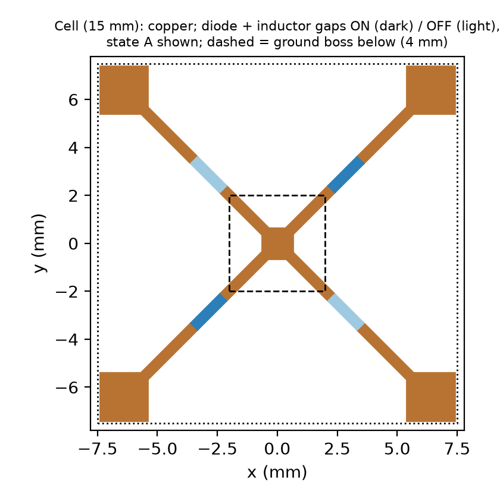
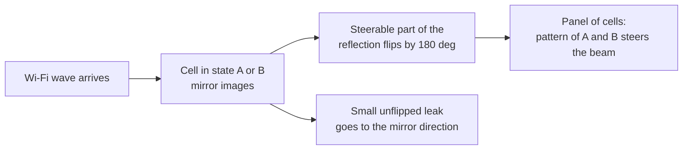

# One switch, three Wi-Fi bands: a smart-mirror cell designed in simulation

**One 15 mm "smart mirror" cell for Wi-Fi whose single on/off setting serves 2.4 GHz and 5.15-7.125 GHz, meeting a 2 dB loss budget at every simulated angle but one, with the strict phase target met only in part: simulation only, nothing built or measured.**

[](https://doi.org/10.5281/zenodo.23165406)  [](https://github.com/Hashirama1337s)

Moki & Julio · 2026 · version 1.0.0

**Status: simulation only (Palace 0.18.1 full-wave FEM + exact network algebra). Nothing has been built or measured.**
Release 1.0.0. **Re-run** `python reproduce.py` (about a minute) · **Files** [MANIFEST.md](MANIFEST.md) · **Full
details** [TECHNICAL.md](TECHNICAL.md)

## In plain words

Wi-Fi often has dead zones: behind a wall, around a corner. A reconfigurable intelligent surface (RIS) is a flat panel
of small cells that can each flip the radio wave they reflect. Set the right pattern of flips and the panel steers Wi-Fi
into the dead zone, with no radio or amplifier of its own.

A picture that helps: **a stadium card stunt.** Each person holds a card that is one colour on one side and another on
the back; together the flips make a picture. Here each cell has two states, and the pattern of states shapes where the
reflected wave goes. Where the picture breaks: the cards only need to look right at one moment, while a radio cell must
flip the wave the same way at every frequency it serves, and that is the hard part.

The problem we started from was named in the PARISO paper (Sekharan et al. 2026): a cell's switched phase drifts between
the 2.4, 5 and 6 GHz Wi-Fi bands, so a pattern that works in one band fails in another. We designed one cell whose one
switch state serves 2.4-2.4835 GHz and the full 5.15-7.125 GHz span. We did not find a published cell that covers both
with one shared bit; "not found" is not proof.

The cell meets a 2 dB loss budget at every simulated angle except one: a wave arriving at 45 degrees along the cell's
diagonal. And the "bit" (the flip) meets the usual strict target only straight on, with typical parts, in the 5-7 GHz
band. This is a design on a computer. Nobody has made or measured one.

## At a glance

*The exact claims, for specialists. Terms are explained in "How it works" and "Words you will meet".*

- **Design.** Period 15 mm; ground with a raised 4 x 4 mm boss / 12.75 mm air spacer / RO4003C 0.508 mm / one copper
  layer; 4 x MACOM MADP-000907-14020 PIN diodes, each in series with a 2.3 nH 0201 chip inductor with a high
  self-resonance (16.5-20 GHz verified); designed for 0.015 pF mounting capacitance per diode.
- **Results (worst case over the parts box, all cells in the same state).** Loss 0.81-0.91 dB straight on; at most
  1.24 dB at 45 deg along the edges and at 30 deg along the diagonal (1.37 dB at 2.4 GHz); 45 deg along the diagonal
  misses (2.21 / 2.28 dB). The steered beam changes by at most 0.12 dB because of the leak (array-factor check).
- **Design rules.** The series inductor needs a high self-resonance (parts at 16.5-20 GHz pass, a 10 GHz part fails);
  the land pattern must be designed in, because the bit phase is far more sensitive to mounting capacitance than the
  loss is.
- **Option.** A lower-capacitance diode (MACOM MA4AGFCP910): 1.9 nH gives the best phase (17.6-17.8 deg straight on,
  typical parts); 2.5 nH meets 2 dB at every simulated angle in 5-7 GHz but misses the diagonal at 2.4 GHz (2.32 dB).
- **Prior art.** The four-PIN mirror architecture is known (Zhang et al., IEEE TAP 2016; CN116598793A); the shared
  tri-band bit (single layer, air spacer) and the series inductor as the third-band lever were not found ("not found" is
  not proof); the boss and via are partly known. Live
  patents exist in this family; anyone building hardware should check freedom to operate.

Every table, figure, method step, open issue and reference: [TECHNICAL.md](TECHNICAL.md).

## What we do not claim

- **Nothing was built or measured.** Every number is from simulation: copper as a perfect conductor, diodes as lumped
  circuits, land pads as one lumped capacitance; no land-pattern simulation, no foam spacer, no copper loss.
- 45 deg along the cell diagonal misses 2 dB (2.21 dB at 2.4 GHz, 2.28 dB at 5-7 GHz). This is a wall-mount design;
  on a ceiling that angle is common.
- The strict 180 +- 20 deg bit is met only straight on with typical parts at 5-7 GHz (19.3 deg); worst case straight on
  is 27-30 deg, and up to 46 / 70 deg at 45 deg tilt.
- Headline numbers assume all cells in the same state. Neighbours in the opposite state were checked only on the
  earlier v3 shape and only for one code; there, alternating neighbours raise absorption 1.8-2.9 times in 5-7 GHz.
- The bias network is preliminary (earlier shape, 4 frequencies, diagonal plane not run). The mesh was checked only at
  0 deg on the earlier shape; oblique incidence was not mesh-checked.
- One frozen code steers different frequencies to different angles; the panel demo is an array factor only.

## How it works

### The idea



The designed cell is a copper pattern 15 mm wide on a thin board, held above a metal ground plate. Four tiny switches (PIN
diodes) sit in its diagonal arms. In state A one diagonal pair conducts; in state B the other pair does, which is the
mirror image. The steerable part of the reflection comes back with its polarisation (the direction its electric field
points) turned, and because the two states are mirror images, that part flips by 180 degrees between them (for a wave polarised along a cell edge, to within 1.33 degrees).



Three ideas make it work across bands: (1) the mirror-symmetric, polarisation-rotating layout; (2) a small chip
inductor in series with each diode, which opens the third band; (3) a small raised metal block (a "boss") under the
centre with a short via (a metal-plated hole joining two layers), which removes a resonance that only appears when the wave comes in at a tilt.

### A worked example

Simulating every combination of parts with the field solver would be slow. Instead, each copper pattern is simulated
once, with a "port" at every diode site. After that, exact network algebra gives the response for any diode,
tolerance, mounting capacitance or chip part, without a new run.

Two numbers score the cell:

- **Loss** = how much of the incoming power does not end up in the steerable beam (absorbed in the parts and board, or
  left in the unflipped leak), in decibels (dB). Every 1 dB is a fixed fraction of the power: 2 dB means about 37 % lost.
- **Equivalent bit-phase error** = how far the flip is from a clean 180 degrees, counting the leak. The usual target is
  180 +- 20 degrees, so an error of 20 degrees or less.

A worked example from the release table (worst case over the whole "parts box": diode spread, inductor tolerance,
0.013-0.017 pF of mounting capacitance):

| wave arrives | loss 2.4 GHz | loss 5-7 GHz | bit-phase error 2.4 / 5-7 GHz |
|---|---|---|---|
| straight on | 0.91 dB | 0.81 dB | 27.2 / 30.1 deg |
| 45 deg, along a cell edge | 1.04 dB | 1.24 dB | 35.4 / 45.5 deg |
| 45 deg, along the diagonal | 2.21 dB (misses) | 2.28 dB (misses) | 67.7 / 70.3 deg |

Straight on with typical parts, the error is 22.6 / 19.3 degrees: the 5-7 GHz band meets the 20-degree target; the
2.4 GHz band and the worst-case parts do not. The diagonal miss is a geometric limit of a single copper layer: even
loss-free switches leave a 93-degree error there in this shape.

## Reproduce and reuse

Questions this lets you answer:

- How would this cell do with a different diode, inductor or mounting capacitance, without re-running the field
  solver?
- Why does a common 10 GHz-self-resonance inductor break the 5-7 GHz band?
- How does a 32-cell panel steer a beam with a 1-bit code? (Illustrative array factor only.)

**Re-run the results tables** (Python 3.11 with numpy and matplotlib, `pip install -r requirements.txt`; no field
solver needed, the network files are in `data/`). The repository has no hash manifest, so a default clone is fine.

```
git clone https://github.com/Hashirama1337s/moki-julio-wifi-ris-cell
cd moki-julio-wifi-ris-cell
python reproduce.py
python array_demo.py
```

`reproduce.py` prints every row of the results tables, for example

```
0 deg                               0.91 /  0.81                  27.2 /  30.1     (101 frequencies, TE incidence)
```

and `array_demo.py` redraws `figures/fig4_beam_steering.png` (byte-identical in our check).

**Try your own parts.** The network files can be closed with any load. From `scripts/`, this re-scores the earlier v3
shape (the `boss_*` files) with a 2.0 nH chip inductor whose self-resonance is 20 GHz, then 10 GHz:

```
cd scripts
python real_all.py --srf 20 --L 2.0 --cp 0
python real_all.py --srf 10 --L 2.0 --cp 0
```

Straight on, the worst-case loss goes from 1.05 dB to 2.77 dB: the low-self-resonance part breaks the band, as the
design rule says. `--L` takes several inductances and `--cp` several mounting capacitances (pF). The field-solver
drivers (`palace_mp_pol.py`, `super_mp.py`) need Palace 0.18.1 on Linux and are listed in [MANIFEST.md](MANIFEST.md).

## Words you will meet

- **RIS (reconfigurable intelligent surface)** - a panel of switchable cells that steers reflected radio waves.
- **1-bit cell** - a cell with two states whose reflections should differ by 180 degrees.
- **PIN diode** - a small switch for radio signals: it conducts when on and acts like a tiny capacitor when off.
- **GHz** - billions of cycles per second; Wi-Fi uses about 2.4 GHz and 5-7 GHz.
- **dB (decibel)** - a log scale for power ratios; 2 dB of loss means about 37 % of the power is lost.
- **Polarisation** - the direction in which the wave's electric field points.
- **Self-resonance (SRF)** - the frequency above which a chip inductor stops acting like an inductor.
- **Full-wave FEM** - a solver that computes the electromagnetic field by splitting space into small pieces.
- **Network algebra** - treating the cell as a box with ports, so new parts can be plugged in by calculation.
- **Array factor** - the beam pattern of a panel computed from each cell's response, ignoring cell-to-cell coupling.

## How to cite

```
Moki & Julio (2026). One switch, three Wi-Fi bands: a 1-bit polarisation-rotating RIS cell (simulation study). Version 1.0.0. Zenodo. https://doi.org/10.5281/zenodo.23165406
```

The DOI always resolves to the newest archived version. Machine-readable: [CITATION.cff](CITATION.cff).
Copyright (c) 2026 Moki & Julio. Design, text, figures and data: CC BY 4.0 (LICENSE; summary in LICENSE-docs-data.md). Code: MIT (LICENSE-CODE).

## Related projects

- [kinect-v1-depth-levels](https://github.com/Hashirama1337s/kinect-v1-depth-levels): the Xbox 360 Kinect measured as an instrument
- All projects: [the Moki & Julio lab map](https://github.com/Hashirama1337s)

---

*Prepared with AI assistance; what was checked, and by what, is stated above.*
